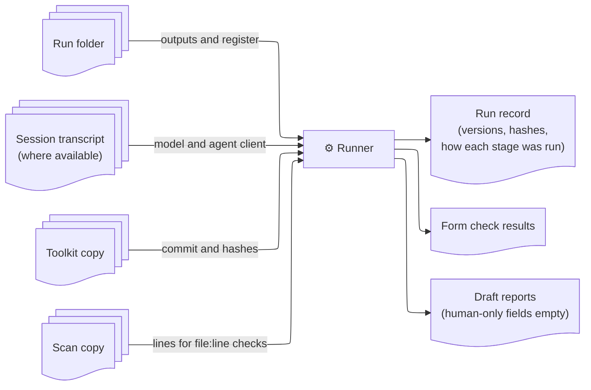

# Record and check every stage

## Summary

The runner records, checks and reports on every stage of a review. The reviewer runs each stage in their coding agent as the toolkit describes, and the runner works from what the stage left behind: its outputs, its session transcript, the toolkit copy and the scan copy. This needs no model access and changes nothing about how the reviewer works.

## Context

The toolkit asks for each run to record the model, prompt-pack version, prompt IDs and agent client (`vendor/gc3-ai-sast-toolkit/1-prompts/README.md:37-46`, `vendor/gc3-ai-sast-toolkit/CLAUDE.md:34-35`), and treats a machine-readable register as the source of truth (`vendor/gc3-ai-sast-toolkit/1-prompts/staged/00-run-control-and-evidence-model.md:214-216`). Doing this by hand is where runs become inconsistent and hard to audit.

None of this depends on what ran the stage. The same things need recording and checking whoever or whatever ran it, so the runner works only from the stage's outputs and never assumes how they were made.

## Decision

For every stage, the runner:

- **records what was used:** the toolkit commit and content hashes (as in [ADR 0001](0001-runner-separate-from-toolkit.md)), the prompt IDs, and the model and agent client where known, taken from the transcript's metadata or entered by the reviewer, never from the model's own account
- **captures what the stage produced:** its outputs in the run folder and, where available, the session transcript
- **checks what can be checked mechanically:** for example the scope re-anchor line, the evidence labels from stage 00, `file:line` citations that point at real lines in the scan copy, stable ID formats and the register's required fields
- **drafts reports** from the register, leaving human-only fields and missing evidence visibly empty

## Considered options

- **Let the coding agent record itself, as the toolkit asks.** Rejected. A model's own report of its version, or of what it read, is not independent. File hashes and citation checks have to come from outside the agent.
- **Have a model review each stage's outputs instead of mechanical checks.** Rejected. The review would not be repeatable, it would need model access just to check, and it would drift into judging whether findings are correct, which belongs to the reviewer.
- **Tie recording to one way of running stages.** Rejected. Stages run any other way would have no record, and runs done different ways could not be compared.

## Consequences

- The checks confirm form, not correctness: the runner reports "form checks passed", never "verified".
- The run record says how each stage was run, and stages that stop early are recorded as incomplete.
- The checks accept every label the toolkit defines, including `locally-validated`, which a reviewer can reach in stage 02.
- This part never calls a model, so it is tested with fixtures only.
- Issue #2 is to be reordered to build this first.

## When to revisit

- The maintainers do not want a tool like this at all (archive the runner).
