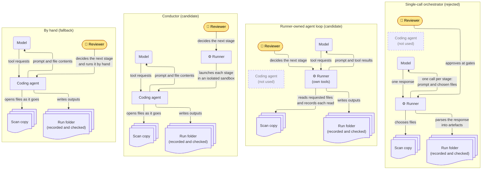

# How the runner runs each stage

## Summary

**Proposal.** On top of the recording and checking in [ADR 0002](0002-record-and-check-every-stage.md), add one of two ways for the runner to run stages itself:

- the **conductor**, which launches the department's approved coding agent
- the **runner-owned agent loop**, which calls the model directly

Which one comes first depends on what departments using the toolkit typically have approved, which the maintainers are asked. Until then, and if the maintainers do not want stages run automatically, reviewers run stages by hand.

**Status.** Proposed, not accepted. The details of how each approach is built will be added once the maintainers have answered the questions this decision [depends on](#depends-on-the-maintainers).

## Context

The runner needs a way to run each stage prompt against the scan copy. Two constraints shape the choice:

- **The prompts assume an agent that opens files as it goes**, not one that is handed a fixed set of files.
- **Departments approve different things.** Some have approved a coding agent such as Claude Code or Codex; some have approved direct model access such as Amazon Bedrock; some may have neither.

Whichever way runs a stage, the runner should give every run a consistent procedure and enforced permissions, without making methodological choices the toolkit does not define. The reviewer decides whether to run the next stage.

## Depends on the maintainers

This decision waits on the maintainers' answers to the [proposal](https://github.com/sumau/GC3-AI-SAST-Toolkit/issues/1#draft-proposal-to-post-upstream), which holds the questions. It depends on:

- whether the runner should run stages, or only record and check stages the reviewer runs by hand
- what departments using the toolkit typically have approved: a coding agent, direct model access, or both
- whether stages share one agent session, and how stage 00 is applied. The toolkit's wording leans towards one session (`vendor/gc3-ai-sast-toolkit/1-prompts/README.md:9`, `vendor/gc3-ai-sast-toolkit/1-prompts/README.md:27`).

## Considered options

In every option, the run folder is recorded and checked as in ADR 0002.

- **By hand (fallback).** The reviewer runs every stage in their coding agent. The runner does not run stages.
- **Conductor (candidate).** The runner launches the reviewer's coding agent, inside an isolated sandbox, with the stage prompt. The agent reads the scan copy and writes its outputs to a run folder. The runner holds no model credentials. This automates the setup the toolkit already describes (`vendor/gc3-ai-sast-toolkit/README.md:13-38`).
- **Runner-owned agent loop (candidate).** The runner gives the model its own tools (list, read and search within the scan copy; write within the run folder) and runs the tool-use loop itself, calling the model directly.
- **Single-call orchestrator (rejected).** The runner sends each stage prompt and a selection of files to a model in one call per stage.

## Trade-offs

**Conductor or runner-owned agent loop.** The deciding difference is which program sends the department's source code to the model. With the conductor, it is the coding agent the department has already approved. With the agent loop, it is the runner, which needs its own approval unless the department already trusts a direct model endpoint such as Amazon Bedrock.

On technical grounds, the agent loop is the better design: permissions hold by construction, the runner records every file read itself, and it can be tested deterministically. The conductor needs only an approved coding agent, at the cost of depending on agents the runner does not control and on a correctly set up sandbox. So the choice turns on what departments have approved, not on the design.

Building both roughly doubles the stage-running work, so only one is built first, behind an interface that leaves room for the other.

**Why not leave every stage to be run by hand.** It leaves what the agent may do, which configuration loads and what happens when a stage stops early to each reviewer. It remains the fallback if the maintainers do not want stages run automatically.

**Why not the single-call orchestrator.** The runner would have to choose which files the model sees, which the methodology does not define and the prompts do not expect.

## Consequences

Whichever approach is built:

- The model can read the scan copy and write only to the run folder, with no shell and no network. So stage 02's optional local validation is not possible, and no result is `locally-validated`.
- No test calls a real model.

## When to decide or revisit

Decide which way of running stages to build first when the maintainers say what departments typically have approved, and fill in how it is built at that point.

Revisit this decision if:

- the maintainers prefer no automation (leave stages to be run by hand)
- no supported agent can be held to the permissions above (rule out the conductor, and use the runner-owned agent loop where direct model access allows)
- departments that need the other approach start using the runner (build the second way of running stages)
