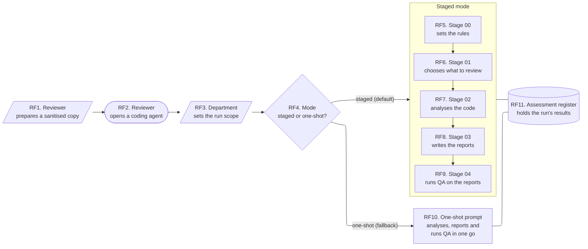
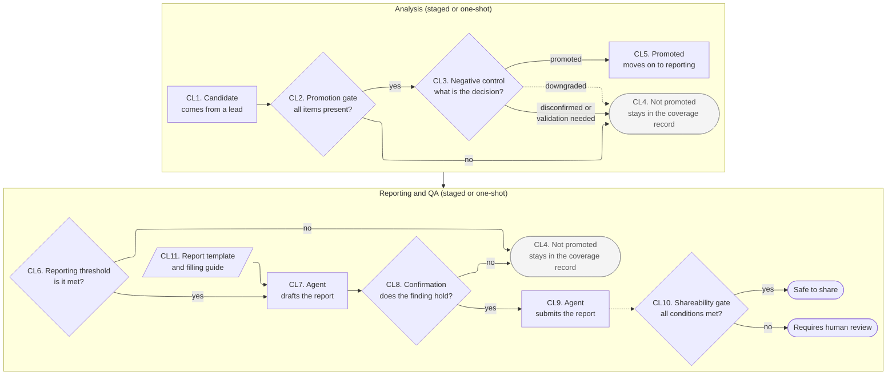

# The GC3 AI SAST Toolkit's workflow

This document describes the workflow the GC3 AI SAST Toolkit defines, as the runner needs to understand it. It is a paraphrase for runner developers, not a copy of the toolkit and not a substitute for it. The toolkit stays the source of truth.

- **Toolkit version described:** commit `0ec2ffe363346ece896173e92b49a6cc595d9c73` of `https://github.com/uk-gov-cyber/GC3-AI-SAST-Toolkit`, pinned at `vendor/gc3-ai-sast-toolkit`.
- **Citations:** every claim cites `path:NN-MM`, with paths relative to the toolkit root (`vendor/gc3-ai-sast-toolkit/`). In a stage's own section and in [One-shot mode](#one-shot-mode), a bare `:NN-MM` refers to that section's prompt file. Line numbers are valid only for the commit above; `manifest.toml` records each file's hash at that commit.
- **Machine-readable summary:** `manifest.toml` (draft).

## Overview

The toolkit is documentation only: prompts, a reporting bundle and agent instructions (`README.md:5-11`). These diagrams show its intended journey (`README.md:40-46`) and summarise the rest of this document, which gives the detail the runner needs to record and check each step. Each box is numbered, and the key under each diagram says what that step does and where the toolkit defines it, so the diagrams can be checked against the toolkit without reading the prose below. Boxes are numbered RF1 to RF11 in the run flow and CL1 to CL11 in the candidate lifecycle.

How to read them:

- A rectangle is a step or an output; a slanted box is an input prepared outside the run; a diamond is a decision; a rounded box is where the run starts or a candidate ends up; the cylinder is a shared file.
- A solid arrow is a flow the toolkit defines. A line without an arrowhead means the stages read and update that file.
- A dotted arrow is a flow the toolkit mentions but does not define. Each one is an open question.

### Run flow

| # | What happens | Defined in |
|---|---|---|
| RF1 | A local copy of the target with `.git/` removed and secrets and personal data redacted, approved before the run. The toolkit does not say how; stage 02 stops if it is not done. | `CLAUDE.md:18`, `README.md:29-36`, `1-prompts/staged/02-full-sast-attack-path-prompt.md:93-98` |
| RF2 | Opened at the toolkit root, so its `CLAUDE.md` or `AGENTS.md` loads with the reviewer's limits and the workflow and reporting rules. `AGENTS.md` has the same content for agents that read that file instead, and says it is kept in step with `CLAUDE.md`. | `README.md:13-38`, `CLAUDE.md:7-44`, `AGENTS.md:1-5` |
| RF3 | The severity and reporting thresholds and the attacker classes in scope. The prompts never invent them; the toolkit defines no format. Departmental pre-requisites live in separate written guidance that is not in the repository. | `CLAUDE.md:38-40`, `1-prompts/staged/00-run-control-and-evidence-model.md:22`, `CLAUDE.md:18`, `2-reporting-bundle/README.md:14` |
| RF4 | Staged is the default. One-shot is only for departments that cannot run the staged workflow. | `1-prompts/README.md:7-19` |
| RF5–RF9 | The five staged prompts, run in order. See [Staged mode](#staged-mode). | `1-prompts/README.md:7-15` |
| RF10 | A smaller version of stages 00 to 04 in one prompt, writing seven files. A separate mode, not an extra stage. See [One-shot mode](#one-shot-mode). | `1-prompts/one-shot-minimum-sast-prompt.md:15-28`, `:168-291` |
| RF11 | In staged mode, the single source of truth between stages: stage 01 starts it, each later stage updates it, and every Markdown table and report must agree with it. In one-shot mode, just one of the output files. | `1-prompts/staged/00-run-control-and-evidence-model.md:214-240`, `1-prompts/staged/01-repo-triage-prompt.md:125`, `1-prompts/one-shot-minimum-sast-prompt.md:176-206` |

The diagram leaves out the next-step recommendations at the end of stages 01 to 03 and the one-shot prompt; see [Branching and loops](#branching-and-loops).

### Candidate lifecycle and reporting

This zooms in on part of the run flow. The analysis group is RF7 (stage 02), or the analysis part of RF10 (the one-shot prompt). Only this group is the toolkit's candidate lifecycle: every candidate ends in one of its seven lifecycle states, at CL4 or CL5 (`1-prompts/staged/00-run-control-and-evidence-model.md:165-177`). The reporting steps after it change a report's status, not the candidate's lifecycle state. The reporting and QA group uses the report template (CL11) and stage 04's QA (RF9), or the one-shot prompt's self-QA pass (part of RF10).

| # | What happens | Defined in |
|---|---|---|
| CL1 | Something worth checking. Scanner and AI output is only ever a lead, never a finding on its own. | `1-prompts/staged/00-run-control-and-evidence-model.md:192-194` |
| CL2 | Stage 00's six required items (source, sink, path, missing control, consequence, assumptions), which stage 02 checks as five gates with `file:line` evidence plus two conditional ones (endpoint authorisation, cross-service data). Analysis stops at the first failure. | `1-prompts/staged/00-run-control-and-evidence-model.md:179-190`, `1-prompts/staged/02-full-sast-attack-path-prompt.md:21`, `:28-40` |
| CL3 | The agent argues the strongest false-positive case, then decides. The "downgraded" arrow is dotted because the toolkit does not say which state it ends in. | `1-prompts/staged/02-full-sast-attack-path-prompt.md:63-77`, `1-prompts/one-shot-minimum-sast-prompt.md:152-166` |
| CL4 | One of five states (validation candidate, hardening item, duplicate, disconfirmed, out of scope), each with a reason, kept in the coverage record and never dropped. Drawn in both groups only for layout. | `1-prompts/staged/00-run-control-and-evidence-model.md:165-177`, `CLAUDE.md:24`, `2-reporting-bundle/reporting-standards.md:11` |
| CL5 | A promoted finding, or a promoted chain of findings. | `1-prompts/staged/00-run-control-and-evidence-model.md:165-177` |
| CL6 | Findings below the run scope's reporting threshold go to the coverage record instead. | `2-reporting-bundle/templates/agent-filling-guide.md:46-48` |
| CL7 | One report per finding, copied from the template outside the toolkit, with status Draft. | `2-reporting-bundle/templates/agent-filling-guide.md:37-44`, `CLAUDE.md:26-36` |
| CL8 | Stage 02's confirmation prompts, run against a coding agent, ideally a different one. The negative-control prompt is mandatory, only real responses count, and a genuine reason the finding fails means no report. | `2-reporting-bundle/templates/agent-filling-guide.md:92-105`, `2-reporting-bundle/templates/vulnerability-report.md:321-328` |
| CL9 | Every checklist box ticked, status set to Submitted, no edits afterwards. | `2-reporting-bundle/templates/agent-filling-guide.md:125-139`, `CLAUDE.md:33` |
| CL10 | Stage 04 needs all sixteen listed conditions; one-shot's self-QA sorts reports the same way with a shorter checklist. The arrow is dotted because neither is said to apply to template reports. | `1-prompts/staged/04-normalisation-and-qa-prompt.md:161-182`, `1-prompts/one-shot-minimum-sast-prompt.md:272-291` |
| CL11 | Filled whenever a finding is reported, in either mode. Neither stage 03 nor the one-shot prompt mentions it, so how their own reports relate to it is not stated. | `CLAUDE.md:26-36`, `2-reporting-bundle/README.md:16-27` |

## Cross-cutting rules

- **Stable IDs.** Repositories `R###`, findings `R###-F###`, chains `C###`, validation tasks `V###`, remediation tasks `A###`, patterns `P###` (`1-prompts/staged/02-full-sast-attack-path-prompt.md:286-297`), plus artefacts `ART###` (`1-prompts/staged/03-security-reporting-output-prompt.md:296-298`) and routing confirmations `RC###` (`1-prompts/staged/01-repo-triage-prompt.md:108`).
- **Scope re-anchor.** Each later response starts with a one-line statement of the current task, in a fixed form (`1-prompts/staged/00-run-control-and-evidence-model.md:25-33`). Each stage gives its own line (`1-prompts/staged/01-repo-triage-prompt.md:11-15`, `1-prompts/staged/02-full-sast-attack-path-prompt.md:9-13`, `1-prompts/staged/03-security-reporting-output-prompt.md:11-15`, `1-prompts/staged/04-normalisation-and-qa-prompt.md:5-11`, `1-prompts/one-shot-minimum-sast-prompt.md:7-13`). This is a mechanically checkable property of each stage's output.
- **Adapting the prompts.** A department may add to the prompts, as long as nothing weakens the gates on evidence, the record of what was covered or the negative control, and it notes the change in the run scope (`1-prompts/README.md:48-50`).

## Versioning and identifying a toolkit copy

### What the toolkit asks to be recorded

- **Per run:** model name and version, prompt-pack version, prompt IDs used, and agent client and version, so that past findings can be reproduced (`1-prompts/README.md:37-46`).
- **Per report:** the discovery tool, model and version, the prompt-pack version and prompt IDs, and the same again for confirmation (`CLAUDE.md:34-35`, `2-reporting-bundle/README.md:24`). The report template has a prompt-pack version field in its metadata and in its confirmation section, and its checklist requires both (`2-reporting-bundle/templates/vulnerability-report.md:32`, `2-reporting-bundle/templates/vulnerability-report.md:192`, `2-reporting-bundle/templates/vulnerability-report.md:375`). The filling guide treats it as a required input and a common gap to fix before submitting (`2-reporting-bundle/templates/agent-filling-guide.md:24`, `2-reporting-bundle/templates/agent-filling-guide.md:42`, `2-reporting-bundle/templates/agent-filling-guide.md:135`, `2-reporting-bundle/templates/agent-filling-guide.md:151`).
- **In the one-shot register:** a `prompt_pack_version` field in the run metadata, next to the model name and version (`1-prompts/one-shot-minimum-sast-prompt.md:182-194`).

The toolkit never says what a prompt-pack version looks like or where to find it. It is a free-text field.

### What versions exist

Checked on 2026-10-27 against the pinned commit and the upstream repository:

- **No git tags**, locally or on the remote.
- **No GitHub releases.**
- **No version file.** The only version string in the toolkit is "v1.0" in the report template's header comment (`2-reporting-bundle/templates/vulnerability-report.md:3`). It labels that one template, not the prompt pack.

### How the runner identifies a toolkit copy

This is decided in `docs/adr/0001-runner-separate-from-toolkit.md` ("Release tags"). What fills the toolkit's prompt-pack version fields while no release exists is open, under step 7 in issue #2.

## Staged mode

All five staged files are listed as "use in order" (`1-prompts/README.md:7-15`). None is described as optional, so each is mandatory in staged mode. Stages 01 to 03 each say to apply stage 00 first (`1-prompts/staged/01-repo-triage-prompt.md:9`, `1-prompts/staged/02-full-sast-attack-path-prompt.md:7`, `1-prompts/staged/03-security-reporting-output-prompt.md:9`). Stage 04 does not say so, but uses its labels (`1-prompts/staged/04-normalisation-and-qa-prompt.md:55`).

Each file is `1-prompts/staged/<stage ID>.md`. A bare `:NN` in a row refers to that row's file. "Depends on" records which earlier outputs each stage explicitly consumes.

| Stage ID | Purpose | Main inputs | Main outputs | Depends on | Self-check |
|---|---|---|---|---|---|
| `00-run-control-and-evidence-model` | Sets the rules every later stage follows (`:3`) | The run scope's thresholds and attacker classes (`:22`) | No artefact of its own; defines the rules the later stages apply | none | None; it defines the anti-drift controls the others use |
| `01-repo-triage-prompt` | Chooses and prioritises what to review (`:3-5`) | Approved, sanitised repository copies and signed-off inventories (`:110-112`); scanner output as lead records (`:30-38`, `:53-67`); the run scope (`:138`) | Triage report, registers, the register seed and a stop/continue decision | 00 | Anti-drift checklist (`:69-79`) |
| `02-full-sast-attack-path-prompt` | Source-to-sink analysis of the shortlist (`:3`, `:164-179`) | A fixed list of handoff fields; missing ones are recorded as gaps (`:143-162`). Stops unless the copy is approved, local and sanitised (`:93-103`). | Per-candidate gate results, findings and chains, confirmation prompts, the updated register and the reporting handoff | 00, 01 | Anti-drift checklist (`:79-91`) |
| `03-security-reporting-output-prompt` | Writes the reports from the handoff (`:3-5`) | A fixed list of stage 02 fields, including confirmation prompts and any responses; missing ones stay as visible gaps (`:153-181`) | Per-issue SARIF, OPTRS, VXDF decision and human report; exercise-level artefacts | 00, 02 | Anti-drift checklist and packaging and quality checks (`:97-109`, `:592-616`) |
| `04-normalisation-and-qa-prompt` | QA of the report set as a whole (`:3`) | Drafted reports, the assessment and reconciliation registers, other registers and logs, claims-control entries, stage 00's labels (`:42-57`) | QA findings, the register with a QA status, and lists of reports safe to share or needing human review | 03 (uses 00's labels) | None; it is the QA pass |

The sections below give each stage's limits and full outputs, which the runner checks a stage's results against, and anything else specific to that stage.

### Stage 00: run control and evidence model

- **Limits:** its controls override any later prompt that conflicts with them; the agent keeps this model and states the conflict (`:13`, `:242-244`).
- **What it defines:**
  - the role: nothing the model produces counts as more than a candidate until a person accepts it (`:5-9`);
  - the rules of engagement (`:11-23`);
  - the evidence labels (see [Evidence labels](#evidence-labels));
  - the severity and confidence split (`:79-86`);
  - the disclosure status block every report-ready candidate carries (`:88-119`);
  - remediation planning for shared or high-impact findings (`:121-135`);
  - the cost order (deterministic filtering first, one final normalisation pass last) and a depth budget stated before each phase (`:137-163`);
  - the candidate lifecycle and promotion gate (see [Candidates, promotion and confirmation](#candidates-promotion-and-confirmation));
  - the rule that scanner output is only ever a lead (`:192-194`);
  - the missing-evidence rule: unknown facts are written as not established, and a fixed list of things must never be inferred (`:196-212`);
  - the minimum fields of every register entry (`:214-240`).

### Stage 01: repository triage and handoff

- **Limits:** does no SAST and produces no vulnerabilities (`:3-5`, `:81-92`, `:406-415`).
- **Outputs:**
  - a triage report with seven required sections: executive summary, candidate matrix, exclusion register, watchlist, handoff manifest, execution order, and a stop/continue decision (`:308-404`);
  - a depth-budget statement and five machine-readable registers: scanner leads, review queue, excluded or deferred repositories, an endpoint and authorisation inventory, and a cross-service data-composition map (`:19-28`);
  - a seed of `assessment-register.json` or `.yaml`, described as the contract between prompts (`:125`);
  - per selected repository: at least one reachability proof (`:186-213`), attribution with source and confidence (`:240-265`), and a no-finding coverage seed (`:238`).
- **Classifications it assigns:** repositories into five depth classes, scanner leads into five inspection classes (`:36-37`), endpoint leads into six review classes (`:51`), and priority P1 to P5 with a separate confidence (`:267-291`).

### Stage 02: full SAST and attack-path analysis

- **Outputs:**
  - per candidate: the gate results, canonical labels, the negative-control section and a rules-of-engagement block (`:28-40`, `:53-59`, `:63-77`, `:105-116`);
  - per promoted finding: an attacker-path justification, a feasible attacker outcome, a reachability proof, an endpoint authorisation map where relevant, and downgrade reasons if it is not fully confirmed (`:238-284`);
  - a per-repository section, even when nothing is found, with a fixed list of fields per finding (`:439-505`);
  - pattern definitions, a cross-repository chain register, executive and attribution tables, and a global conclusion (`:527-602`);
  - no-finding coverage notes for every assessed repository (`:339-352`);
  - an analyst activity journal (`:369-380`);
  - a report-ready evidence bundle per material finding and chain (`:382-407`);
  - at least four drafted confirmation prompts per material finding or chain (`:409-418`);
  - the assessment register, updated (`:299-310`, minimum schema at `:731-753`);
  - a required `Reporting Handoff` section with per-finding and per-chain YAML, plus a list of other items (`:604-717`), and a theme-level attacker-path validation handoff (`:719-729`);
  - a stop/continue recommendation (`:179`, `:771`).
- **Optional activities within the stage:** a scanner pre-pass "when permitted" (`:354-367`) and local runtime validation only when it would change confidence, severity or lifecycle state (`:25`, `:61`, `:101`).

### Stage 03: security reporting outputs

- **Limits:** discovers no new vulnerabilities, and changes lifecycle states only if the register contradicts a requested report, in which case it stops and writes a reviewer note (`:3-5`, `:17`).
- **Outputs:**
  - per issue family or chain: SARIF, OPTRS, a VXDF decision, and a Markdown human report (`:183-190`);
  - a long list of exercise-level artefacts, including the whole-exercise executive report, the register, the reconciliation register, aggregate SARIF and OPTRS, routing material, work items, validation packs and a final handoff file (`:192-209`);
  - recommended file names and folder layout (`:211-233`) and a completeness contract with counts to reconcile (`:235-253`);
  - every artefact marked as awaiting normalisation, and handed to stage 04 (`:95`).
- **Rules that apply only here:** full reports only for promoted findings and chains (`:21-22`); only items meeting the run scope's thresholds go through the vulnerability-report bundle (`:113-114`); every finalised item appears in the reconciliation register (`:131-143`); VXDF only for validated chains, otherwise a non-issuance note (`:369-379`); restricted wording for unvalidated behaviour (`:69-91`, `:570-580`).
- **Conditional outputs:** owner delivery packs when the pack is for remediation handover (`:151`); archives and checksums only when packaging is requested (`:201`, `:367`); a private-dependency map where load-bearing (`:274`).

### Stage 04: normalisation and QA

- **Limits:** not a discovery pass, and must not strengthen impact language beyond the evidence (`:3`, `:28-32`).
- **Work:** checks against the run scope's rules of engagement (`:13-26`); a long QA checklist per report (`:59-97`); replacement of near-synonyms with canonical labels (`:99-114`); report-set and artefact-count reconciliation tables (`:116-145`).
- **Outputs:** nine required outputs, including a normalisation summary, QA findings, the register updated with a QA status, lists of reports safe to share and needing human review, and unresolved inconsistencies (`:147-159`); a closing one-line count summary (`:184-190`).
- **Shareability gate:** a report counts as shareable only when all of the listed conditions are met; any other report goes to human review (`:161-182`). No report may be marked safe to share before this stage completes (`1-prompts/staged/03-security-reporting-output-prompt.md:95`).

### Branching and loops

The staged order is linear, but stages 01 to 03 and the one-shot prompt each end with a recommendation to the reviewer about what to do next. This is advice about the run as a whole, not a step in it, and it may send the run elsewhere:

- Stage 01 ends with one of four decisions: continue broad triage, proceed to full SAST, narrow to a targeted pattern hunt, or pause SAST for validation (`1-prompts/staged/01-repo-triage-prompt.md:393-404`).
- Stage 02 ends by recommending one of four next moves: more broad SAST, a targeted hunt for one pattern, validating attacker paths, or stopping (`1-prompts/staged/02-full-sast-attack-path-prompt.md:179`).
- Stage 03 states a recommended next phase (`1-prompts/staged/03-security-reporting-output-prompt.md:620-622`).
- The one-shot prompt ends by recommending one of five next steps, one of which is to re-run with the staged pack (`1-prompts/one-shot-minimum-sast-prompt.md:306-314`).
- After remediation, the relevant staged prompt is re-run against the fixed code (`2-reporting-bundle/reporting-standards.md:158-160`).

The toolkit does not say how these recommendations map onto re-running stages. The question is tracked in [sumau/GC3-AI-SAST-Toolkit#1](https://github.com/sumau/GC3-AI-SAST-Toolkit/issues/1); how the runner handles these recommendations is under steps 2 and 5 in issue #2.

## One-shot mode

- **File:** `1-prompts/one-shot-minimum-sast-prompt.md`
- **Relationship to staged mode:** a fallback for teams that cannot run the staged workflow, not a replacement for it (`1-prompts/README.md:15-19`, `:3-5`). The reviewer chooses it explicitly (`CLAUDE.md:19`, `README.md:43`).
- **What it combines:** scope and depth budget, triage, source-to-sink review, promotion, recording what was not promoted, and a compact report pack with QA, in a single prompt (`:15-28`).
- **Self-contained:** it carries its own rules of engagement and its own copy of the evidence labels rather than referring to stage 00 (`:30-90`).
- **Default depth budget** if the reviewer gives none: one repository, up to 40 files, up to 25 scanner leads, at most 5 fully validated paths, at most 3 examples per pattern (`:103-122`).
- **Promotion gate:** the five core gates only, without stage 02's endpoint-authorisation and cross-service gates as separate gates (`:140-150`), although triage still covers those surfaces (`:135-136`).
- **Outputs:** seven files, written as files if the agent can, otherwise as sections of the response (`:168-291`):

| One-shot output | Nearest staged equivalent |
|---|---|
| `one-shot-sast-summary.md` | stage 01 executive summary and stage 02 global conclusion |
| `assessment-register.json` (with `run_metadata` including model and prompt-pack version) | the assessment register (stages 01 to 03) |
| `findings.md` (compact per-finding reports) | stage 03 human reports |
| `chains.md` | stage 02 chain register and stage 03 chain reports |
| `not-promoted-register.md` | stage 02 no-finding coverage notes |
| `validation-and-remediation.md` | stage 03 validation and remediation action registers |
| `normalisation-and-qa.md` (self-QA) | stage 04 |

The one-shot mode does not produce SARIF, OPTRS, VXDF, routing material or delivery packs. It ends with a fixed one-line count summary and a recommended next step (`:306-314`; see [Branching and loops](#branching-and-loops)).

## Evidence labels

The canonical labels are defined in stage 00 (`1-prompts/staged/00-run-control-and-evidence-model.md:35-77`). The root instructions say to use those definitions and preserve them in every artefact (`CLAUDE.md:22`). There are four families, each a closed set:

| Family | Values | Defined at |
|---|---|---|
| Source status | 4 values, from fully SAST-confirmed to source-disconfirmed | `1-prompts/staged/00-run-control-and-evidence-model.md:41-48` |
| Runtime status | 4 values: locally validated, deployed validated, not validated, not applicable | `1-prompts/staged/00-run-control-and-evidence-model.md:50-57` |
| Reachability status | 5 values, from source-visible to not established | `1-prompts/staged/00-run-control-and-evidence-model.md:59-67` |
| Exploitability status | 5 values: confirmed, hypothesis, config-dependent, private-dependent, disconfirmed | `1-prompts/staged/00-run-control-and-evidence-model.md:69-77` |

Related closed vocabularies:

- **Severity and confidence**, always kept separate: impact severity if exploitable (four levels or the department's scale) and evidence confidence (four levels) (`1-prompts/staged/00-run-control-and-evidence-model.md:79-86`).
- **Vulnerability disclosure status:** classification (6 values), evidence level (5), production impact (4), plus free-text safe/not-safe wording and handling fields (`1-prompts/staged/00-run-control-and-evidence-model.md:92-112`).
- **Lifecycle state:** 7 values (`1-prompts/staged/00-run-control-and-evidence-model.md:165-177`).

The same four families are restated, almost word for word, in the one-shot prompt (`1-prompts/one-shot-minimum-sast-prompt.md:43-90`) and as the allowed values of the report template's evidence-status table (`2-reporting-bundle/templates/vulnerability-report.md:144-154`). Stage 03 requires them in an evidence classification table in every report (`1-prompts/staged/03-security-reporting-output-prompt.md:28-49`), and stage 04 normalises near-synonyms to them (`1-prompts/staged/04-normalisation-and-qa-prompt.md:99-114`).

Several other label sets appear elsewhere and do not map cleanly onto stage 00. How they map onto stage 00's labels is tracked in [sumau/GC3-AI-SAST-Toolkit#1](https://github.com/sumau/GC3-AI-SAST-Toolkit/issues/1).

## Candidates, promotion and confirmation

The candidate diagram above covers the lifecycle, the promotion gate and both negative controls. This section adds only what its key does not.

### Promotion bar and chains

- **Promotion bar.** Stage 02 also requires a credible path to one of eight attacker outcomes, and lists things that never count on their own (`1-prompts/staged/02-full-sast-attack-path-prompt.md:211-236`). A finding is not promoted if its reachability proof leaves out who the attacker is, where they get in, how their input arrives, or which sink it reaches (`1-prompts/staged/02-full-sast-attack-path-prompt.md:280`).
- **Chains** are only as confident as their weakest link, and must cite findings or explicit assumptions (`1-prompts/staged/02-full-sast-attack-path-prompt.md:329-337`).

### Negative control

- Every promoted candidate must re-assess itself after the negative control (`1-prompts/staged/02-full-sast-attack-path-prompt.md:103`). The prompting principles recommend this "argue both sides" pattern generally (`1-prompts/README.md:31`).
- Stage 04 checks the negative-control result is present before a report can be shared (`1-prompts/staged/04-normalisation-and-qa-prompt.md:25`, `1-prompts/staged/04-normalisation-and-qa-prompt.md:174`).

### Confirmation prompts

- **Drafted in stage 02:** at least four per material finding or chain (source-to-sink trace, sanitisation or authorisation check, reachability or configuration gate, negative control), with real file and line values filled in. Responses must not be fabricated (`1-prompts/staged/02-full-sast-attack-path-prompt.md:409-418`).
- **Reported in stage 03:** every material report has a confirmation section with the tool, model and version, each prompt and its response, and the submitter's own view once the negative control has run. Where no independent confirmation took place, the report says so and lists the unrun prompts as next steps (`1-prompts/staged/03-security-reporting-output-prompt.md:436-440`, `1-prompts/staged/03-security-reporting-output-prompt.md:117`).
- **In the report template:** four generic prompts G1 to G4 (`2-reporting-bundle/templates/vulnerability-report.md:201-229`), twelve type-specific prompts (`2-reporting-bundle/templates/vulnerability-report.md:231-319`), and the mandatory negative-control prompt (`2-reporting-bundle/templates/vulnerability-report.md:321-328`).
- **Self-confirmation** is allowed but must be flagged, and is a weaker signal (`2-reporting-bundle/templates/agent-filling-guide.md:99`, `2-reporting-bundle/templates/agent-filling-guide.md:105`, `2-reporting-bundle/templates/vulnerability-report.md:193-199`, `CLAUDE.md:34`).

The minimum number of confirmation prompts differs between files; which one is binding is tracked in [sumau/GC3-AI-SAST-Toolkit#1](https://github.com/sumau/GC3-AI-SAST-Toolkit/issues/1).

## The reporting bundle

### What it contains

- `reporting-standards.md`: the reporting model, including output layers, evidence states, claims control, SARIF, OPTRS, VXDF and routing (`2-reporting-bundle/README.md:5-12`, `2-reporting-bundle/reporting-standards.md:1-160`).
- `review-checklist.md`: questions for people reviewing the method and outputs, and a feedback format (`2-reporting-bundle/review-checklist.md:1-84`). It is for humans; the runner does not need it at run time.
- `templates/vulnerability-report.md`: a 17-section report template, labelled v1.0 in its header comment (`2-reporting-bundle/templates/vulnerability-report.md:1-18`).
- `templates/agent-filling-guide.md`: the procedure an agent follows to fill the template (`2-reporting-bundle/templates/agent-filling-guide.md:1-5`).

### When the template is filled

When the template is filled, and how it relates to stage 03 and the one-shot prompt, is in CL6 to CL9 and CL11. Stage 03's own Markdown human report per finding has a different structure: a decision snapshot, a human summary and eighteen required sections, against the template's seventeen (`1-prompts/staged/03-security-reporting-output-prompt.md:381-418`). The two overlap (evidence status, disclosure status, confirmation, remediation, validation, claims control) but are not the same document. How they relate is tracked in [sumau/GC3-AI-SAST-Toolkit#1](https://github.com/sumau/GC3-AI-SAST-Toolkit/issues/1).

The guide needs five inputs before starting, and says to ask the human reviewer if any is missing (`2-reporting-bundle/templates/agent-filling-guide.md:17-27`): the target repository and commit, the suspected finding, the team and reporter identity, the tool, model and prompt-pack identity, and the run scope.

### How each section is filled

The guide's sixteen steps work through the template in order, because later sections depend on evidence from earlier ones (`2-reporting-bundle/templates/agent-filling-guide.md:29-139`). The "Source" column is where the runner would get the data; "human" means the toolkit expects a person to supply it.

| Template section | Filled by guide step | Source of data |
|---|---|---|
| 1. Report metadata (`2-reporting-bundle/templates/vulnerability-report.md:22-34`) | Step 2 (`2-reporting-bundle/templates/agent-filling-guide.md:37-44`) | Report ID scheme, reporter and team: human. Discovery tool, model and prompt-pack version: run metadata. Status starts as Draft. Tracking ID left blank for the receiving team. |
| (threshold check) | Step 3 (`2-reporting-bundle/templates/agent-filling-guide.md:46-48`) | Run scope. Stop and record as not promoted if below threshold. |
| 4. Affected locations (`2-reporting-bundle/templates/vulnerability-report.md:68-75`) | Step 4 (`2-reporting-bundle/templates/agent-filling-guide.md:50-64`) | Stage 02 handoff: file, lines, function, commit (`1-prompts/staged/02-full-sast-attack-path-prompt.md:610-640`) |
| 2. Summary, 3. Classification, 5. Technical description (`2-reporting-bundle/templates/vulnerability-report.md:36-87`) | Step 5 (`2-reporting-bundle/templates/agent-filling-guide.md:66-70`) | Stage 02 handoff: description, CWE, OWASP, severity (`1-prompts/staged/02-full-sast-attack-path-prompt.md:646-653`) |
| 6. Evidence: source, sink, path, tests (`2-reporting-bundle/templates/vulnerability-report.md:89-129`) | Step 6 (`2-reporting-bundle/templates/agent-filling-guide.md:72-78`) | Stage 02 evidence bundle snippets and test evidence (`1-prompts/staged/02-full-sast-attack-path-prompt.md:393`, `1-prompts/staged/02-full-sast-attack-path-prompt.md:396`). The tests subsection must say explicitly if none exist. |
| 7. Impact (`2-reporting-bundle/templates/vulnerability-report.md:131-142`) | Step 7 (`2-reporting-bundle/templates/agent-filling-guide.md:80-82`) | Stage 02 feasible attacker outcome (`1-prompts/staged/02-full-sast-attack-path-prompt.md:244-248`) |
| 8. Evidence status, 9. Disclosure status (`2-reporting-bundle/templates/vulnerability-report.md:144-166`) | Step 8 (`2-reporting-bundle/templates/agent-filling-guide.md:84-86`) | Stage 00 labels as set in stage 02 (`1-prompts/staged/02-full-sast-attack-path-prompt.md:53-59`), disclosure block (`1-prompts/staged/00-run-control-and-evidence-model.md:92-103`) |
| 10. Proof of concept (`2-reporting-bundle/templates/vulnerability-report.md:168-180`) | Step 9 (`2-reporting-bundle/templates/agent-filling-guide.md:88-90`) | Stage 02 static demonstration (`1-prompts/staged/02-full-sast-attack-path-prompt.md:507-525`), or marked theoretical |
| 11. Coding-agent confirmation (`2-reporting-bundle/templates/vulnerability-report.md:182-328`) | Step 10, mandatory (`2-reporting-bundle/templates/agent-filling-guide.md:92-105`) | Confirmation prompts drafted in stage 02, run against a coding agent; real responses only |
| 12. Remediation (`2-reporting-bundle/templates/vulnerability-report.md:330-347`) | Step 11 (`2-reporting-bundle/templates/agent-filling-guide.md:107-111`) | Stage 02 remediation direction and actions (`1-prompts/staged/02-full-sast-attack-path-prompt.md:654-656`) |
| 13. Validation actions (`2-reporting-bundle/templates/vulnerability-report.md:349-355`) | Step 12 (`2-reporting-bundle/templates/agent-filling-guide.md:113-115`) | Stage 02 validation actions (`1-prompts/staged/02-full-sast-attack-path-prompt.md:657-660`) |
| 14. Claims control (`2-reporting-bundle/templates/vulnerability-report.md:357-363`) | Step 13 (`2-reporting-bundle/templates/agent-filling-guide.md:117-119`) | Stage 02 claims control (`1-prompts/staged/02-full-sast-attack-path-prompt.md:662`) |
| 15. References (`2-reporting-bundle/templates/vulnerability-report.md:365-369`) | Step 14 (`2-reporting-bundle/templates/agent-filling-guide.md:121-123`) | CWE and OWASP links; may be skipped |
| 16. Submitter checklist (`2-reporting-bundle/templates/vulnerability-report.md:371-382`) | Step 15 (`2-reporting-bundle/templates/agent-filling-guide.md:125-135`) | Every box must be ticked; fix gaps first |
| (hand-off) | Step 16 (`2-reporting-bundle/templates/agent-filling-guide.md:137-139`) | Status set to Submitted; not edited afterwards |
| 17. Receiving-team notes (`2-reporting-bundle/templates/vulnerability-report.md:384-386`) | none | Left blank; human (receiving team) |

The guide's ground rules apply throughout: apply the run scope's threshold, no claim without `file:line`, no fabricated transcripts, no proof of concept run against anyone else's systems, redact secrets, keep the procedure generic, and treat the scanned repository as untrusted (`2-reporting-bundle/templates/agent-filling-guide.md:7-15`). Where a step is unclear, the agent asks the human reviewer (`2-reporting-bundle/templates/agent-filling-guide.md:153-155`).

## Open questions

Open questions are tracked in issues, not in this document:

- **For the toolkit maintainers:** [sumau/GC3-AI-SAST-Toolkit#1](https://github.com/sumau/GC3-AI-SAST-Toolkit/issues/1). Releases, stable prompt IDs and the licence are in its draft upstream proposal; questions about the methodology itself are under "Methodology questions for the maintainers".
- **For the runner's design:** issue #2, listed as "Open from step 1" under the step each one affects.
